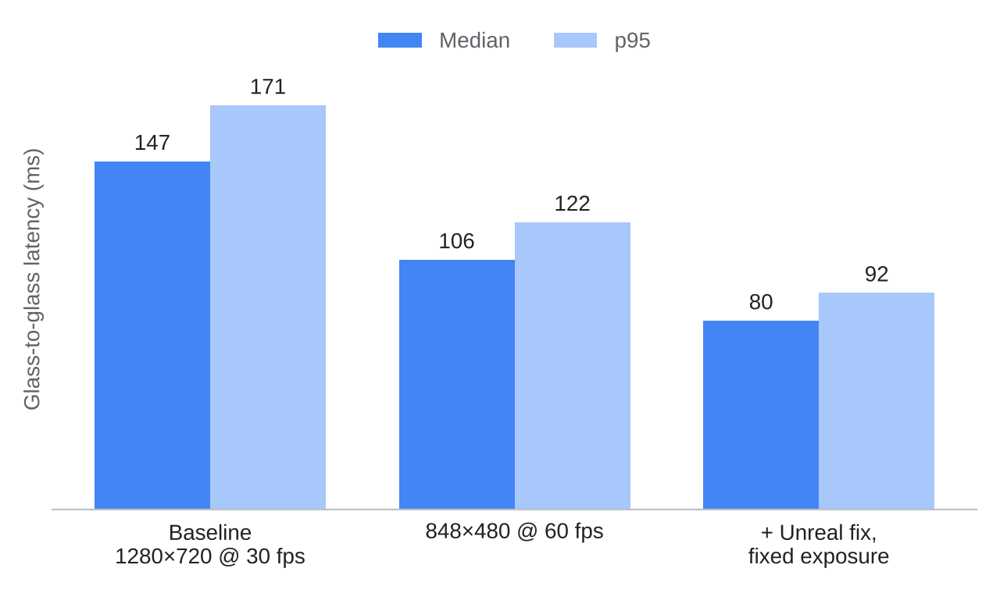

# glass-to-glass-latency

<table>
<tr>
<td width="55%">
A small hardware rig to measure the local glass-to-glass latency of the teleop video path: from light entering the RealSense lens to light leaving the Vive headset display. Built for the <a href="https://github.com/AlexanderWegenerRobotics/teleop-avatar">teleop-avatar</a> streaming pipeline, but it treats the system as a black box, so it works for any camera → display chain.
</td>
<td width="45%"></td>
</tr>
</table>

---

## How it works

An Arduino turns on an LED in front of the camera (t0). The frame goes through the normal pipeline: capture, encode, RTP, decode, Unreal, headset. A light sensor taped on the headset lens sees the display get brighter (t1). The Arduino measures t1 − t0 with its own clock, so there's no clock sync involved and the USB/serial link to the PC doesn't add to the number, it only carries the result afterwards.


One sample per 0.4–0.8 s (random gap so the LED doesn't phase-lock to the camera frame clock). A run of ~500 samples takes about 8 minutes.

---

## Hardware

| Part | Notes |
|---|---|
| Arduino Uno | any 5 V board with an analog pin works |
| TEMT6000 light sensor | taped flat on one headset lens, facing the display |
| Green 5 mm LED + 220 Ω | green because both the sensor and the camera are most sensitive to it |
| Jumper wires, black tape | tape also goes over the headset proximity sensor so the display stays on |


<table>
<tr>
<td valign="top">
<table>
<tr><th>Arduino</th><th>Goes to</th></tr>
<tr><td>5V</td><td>TEMT6000 V</td></tr>
<tr><td>GND</td><td>TEMT6000 G</td></tr>
<tr><td>A0</td><td>TEMT6000 S</td></tr>
<tr><td>D7</td><td>220 Ω → LED long leg</td></tr>
<tr><td>GND</td><td>LED short leg</td></tr>
</table>
</td>
<td><br><sub>Sensor taped on the lens</sub></td>
</tr>
</table>

---

## Running

1. Flash `firmware/photon_latency/photon_latency.ino` with the Arduino IDE (board: Arduino Uno). Once is enough, it stays on the board.
2. Start the streamer and Unreal so the camera feed is showing in the headset. This has to run **before** the logger, because opening the serial port resets the Uno and it calibrates right away.
3. Put the LED a few cm in front of the RealSense RGB lens so it fills a big part of the frame (blurry is fine). Tape the sensor on the lens where the LED blob shows up.
4. Log a run:

```bash
pip install -r requirements.txt
python tools/log_latency.py COM3 runs/<run_name>/samples.csv --label "d455 30fps exp100 jb0" --summary runs/results_summary.csv
```

The run stops by itself after 400 valid samples (change with `--samples`, `0` runs until Ctrl-C) and prints n, median, p5, p95 and timeouts. Ctrl-C also stops it early and still saves the summary. The summary is also appended to `runs/results_summary.csv`, so runs with different settings end up in one table.

5. Plot it:

```bash
python tools/make_plots.py runs/<run_name>/samples.csv
```

This writes a histogram, CDF and per-sample timeline to `runs/<run_name>/plots/` (PNG and PDF, PDF for Keynote), and a one-row `runs/<run_name>/results.csv` with N, median, percentiles and timeouts.

### Output per run

| File | Content |
|---|---|
| `samples.csv` | `idx, latency_ms, host_time_s, rejected, timeout` per sample |
| `samples.csv.log` | calibration values and Arduino messages with host time |
| `results.csv` | label, N, median, p5/p25/p75/p95/p99, mean, sd, min, max, timeouts, duration |
| `plots/` | histogram, CDF, timeline as PNG + PDF |
| `notes.md` | camera, fps, exposure, encoder, jitter buffer, teleop commit. Write this, numbers without settings are useless later |

---

## Things that matter

- **Fixed camera exposure.** With auto-exposure the camera normalizes LED off vs on and calibration fails (or the sketch reports "lit darker than dark"). It also adds a variable term to the latency. Set exposure and gain in the streamer and note them per run.
- **Calibration.** At start the sketch measures the display brightness with the LED off and on and sets the threshold halfway. It needs at least 15 ADC counts difference. The sketch uses the 1.1 V ADC reference because the headset display is dim at the lens.
- **Expect ~11 ms steps.** Results cluster in bands because the display only updates once per 90 Hz refresh. That's normal, the random gap makes the median correct anyway.
- **Timeouts are data.** A timeout means the display didn't change within 1 s (stream froze or dropped frames). Report the timeout rate next to the median.
- **Samples < 40 ms are rejected** as false triggers (stray light), nothing in the pipeline can be that fast.

---

## Results



| Run | Setup | N | Median | p5–p95 | Timeouts |
|---|---|---|---|---|---|
| `baseline` | D455 1280×720 @ 30 fps | 509 | 147.4 ms | 125–171 ms | 0.2 % |
| `baseline_60fps` | D455 848×480 @ 60 fps | 400 | 105.7 ms | 88–122 ms | 0 % |
| `60fps_jb50 novlog_rscallback` | 848×480 @ 60 fps, eye tracker off the Unreal game thread, fixed exposure 7.8 ms | 400 | 79.9 ms | 68–92 ms | 0.2 % |

Local loop on the Windows PC: D455 → NVENC H.264 → RTP over localhost → Unreal → Vive Pro Eye, mono view, jitter buffer 50 ms, video logging off. Every run is in `runs/results_summary.csv`.

- Two changes carried the gain. Camera 30 → 60 fps (−42 ms, the camera delay is about two frames) and moving the Vive eye-tracker queries off the Unreal game thread, which brought Unreal from ~30 to ~72 fps (−25 ms, measured together with the switch to fixed exposure).
- No measurable effect (≤ 1 ms each): BGRA input to the encoder, multithreaded colour conversion, texture upload on the render thread, jitter buffer 0 vs 50 ms on localhost, librealsense frame callback instead of `rs2::pipeline`.
- Where the 80 ms go (estimate): ~46 ms camera, of which ~17 ms is one frame held by Windows Media Foundation; 4.5 ms encode, UDP and decode; 7.5 ms waiting for the next render frame; ~22 ms Unreal render, compositor and scanout.
- On the robot the camera is read through V4L2 on Linux, so the Media Foundation frame does not exist there. Expected ~63 ms; not measured with this rig.
- 848×480 costs about a third of the visible sharpness compared to 720p.

The two runs from 2026-09-25 (`run01`, `run02`) still had auto-exposure on and were only a first look.

---

## Layout

```
firmware/photon_latency/   Arduino sketch
tools/                     log_latency.py (serial logger), make_plots.py (plots)
runs/                      one folder per run: samples, log, notes
docs/                      images used in this README
```

## License

Apache License 2.0, see [LICENSE](LICENSE).
